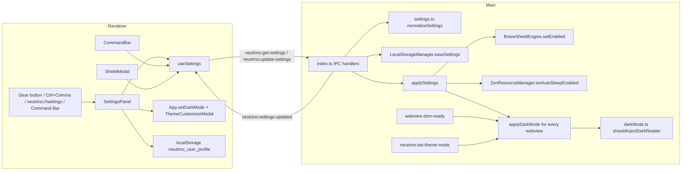

# Design Document: Browser Settings Panel

## Overview

The feature adds a settings panel, a user-editable dark-mode exclusion list and a few cheap settings. Everything reuses code paths the app already has:

- Settings live in the existing `settings` object of `browser-state.json`, owned by `LocalStorageManager` in the main process. A new pure module validates them.
- The main process becomes the only code that injects DarkReader. It skips any host on the exclusion list, and it re-applies dark mode to open webviews when the list or the theme changes.
- The panel is a React modal built from the existing `.modal-overlay`, `.modal-content-card`, `.modal-header`, `.modal-title` and `.close-btn` classes and theme CSS variables, so it follows the active theme and accent.

Two settings stay where they live today, to avoid a migration: the dark or light theme (`neutrino_dark_theme` and `neutrino_simple_theme_v5` in renderer local storage, driven by `App.toggleDarkMode` and `ThemeCustomizerModal`) and the display name (`neutrino_user_profile.name`, written by `WelcomeModal`). The panel edits them through the same functions and keys.

### Relationship to `google-signin-youtube-playback-fix`

Task 3.7 of that spec adds `src/main/darkMode.ts` with `NATIVE_DARK_HOSTS`, a runtime `DARK_SUPPORT_PROBE` and a single main-process injection owner. This spec builds the same `src/main/darkMode.ts` and the single-owner injection, but replaces `NATIVE_DARK_HOSTS` and the probe with the user's exclusion list. If that spec runs later, task 3.7 should drop its `NATIVE_DARK_HOSTS` and probe parts and keep only what this spec has not already done. This spec does not depend on any other task of that spec.

To stay independent, this spec moves `isGoogleAuthUrl` and `isAuthOrSecurityUrl` verbatim from `src/main/index.ts` into `src/main/urlClassifier.ts` so `darkMode.ts` can import them without Electron. Task 3.3 of the bugfix spec later edits that same file instead of creating it.

`tests/unit/preservation.test.ts` Property 12 compares `liveShouldInjectDarkReader` with the original eligibility for URLs outside its `NATIVE_DARK_HOSTS` filter. This spec repoints `liveShouldInjectDarkReader` at `shouldInjectDarkReader(url, DEFAULT_SETTINGS.darkModeExclusions)`. The default list (`youtube.com`) is a subset of that filter, so Property 12 keeps passing, and the DarkReader settings stay `{ brightness: 100, contrast: 95, sepia: 0 }`.

## Architecture



## Components and Interfaces

### `src/main/settings.ts` (new, pure, no Electron import)

The renderer imports this module too (Vite resolves imports outside `src/renderer`), so search-engine labels and host rules exist in one place.

```typescript
export type SearchEngineId = 'google' | 'duckduckgo' | 'bing' | 'brave';

export const SEARCH_ENGINES: Record<SearchEngineId, { label: string; prefix: string }> = {
  google: { label: 'Google', prefix: 'https://www.google.com/search?q=' },
  duckduckgo: { label: 'DuckDuckGo', prefix: 'https://duckduckgo.com/?q=' },
  bing: { label: 'Bing', prefix: 'https://www.bing.com/search?q=' },
  brave: { label: 'Brave Search', prefix: 'https://search.brave.com/search?q=' },
};

export interface BrowserSettings {
  darkModeExclusions: string[];
  adblockEnabled: boolean;
  zenSleepEnabled: boolean;
  searchEngine: SearchEngineId;
  [unknownKey: string]: unknown; // kept as saved, e.g. the legacy `theme` key
}

export const DEFAULT_SETTINGS: Readonly<BrowserSettings>; // ['youtube.com'], true, true, 'google'

/** Fills missing or invalid fields with defaults, keeps unknown keys. Idempotent. */
export function normalizeSettings(raw: unknown): BrowserSettings;

/** "https://www.YouTube.com:443/watch?v=1" -> "youtube.com"; returns null when no valid hostname remains. */
export function normalizeHostEntry(input: string): string | null;

/** host === entry || host.endsWith('.' + entry), both lowercased, leading "www." removed. */
export function hostMatches(host: string, entry: string): boolean;

/** Host of an http(s) URL with a Host_Match in the list. False for other schemes or bad URLs. */
export function isHostExcluded(url: string, exclusions: readonly string[]): boolean;

/** Normalized host of an http(s) URL, or null. Used for the "this site" action. */
export function hostForExclusion(url: string): string | null;

export function addExclusion(list: readonly string[], input: string):
  { list: string[]; error?: 'invalid-host' };
export function removeExclusion(list: readonly string[], entry: string): string[];
/** Removes every entry matching the URL's host, or adds the host when none matches. */
export function toggleSiteExclusion(list: readonly string[], url: string): string[];

export function buildSearchUrl(engine: SearchEngineId, query: string): string;
```

Rules inside `normalizeSettings`:
- `darkModeExclusions`: when the field is an array, each string goes through `normalizeHostEntry`, invalid ones are dropped and duplicates removed in first-seen order. When the field is missing or not an array, the default list is used. An empty saved array stays empty (the user removed the default).
- `adblockEnabled`, `zenSleepEnabled`: booleans, else default `true`.
- `searchEngine`: a known id stays. A legacy URL prefix (the current default is `https://www.google.com/search?q=`) maps to the id whose `prefix` it equals. Anything else becomes `'google'`.
- A valid hostname has 1 to 253 characters, labels of `[a-z0-9-]` from 1 to 63 characters that do not start or end with `-`, and at least one dot, or is exactly `localhost`.

### `src/main/urlClassifier.ts` (new, pure)

Holds `isGoogleAuthUrl` and `isAuthOrSecurityUrl`, moved verbatim from `src/main/index.ts`. `index.ts` imports and re-exports them so current imports keep working.

### `src/main/darkMode.ts` (new, pure)

```typescript
export const DARK_READER_SETTINGS = Object.freeze({ brightness: 100, contrast: 95, sepia: 0 });

/** Same base rules as today, minus excluded hosts. */
export function shouldInjectDarkReader(url: string, exclusions: readonly string[]): boolean {
  if (!url || url.startsWith('neutrino://') || url.startsWith('about:')) return false;
  if (isAuthOrSecurityUrl(url)) return false;
  return !isHostExcluded(url, exclusions);
}

/** Page scripts, built from DARK_READER_SETTINGS so the literal stays in one place. */
export const DARK_READER_ENABLE_SCRIPT: string; // setFetchMethod + enable({...}) + __neutrino_darkreader_active = true
export const DARK_READER_DISABLE_SCRIPT: string; // disable() + __neutrino_darkreader_active = false
```

The enable script still contains the literal `DarkReader.enable({ brightness: 100, contrast: 95, sepia: 0 })`, which Property 12 scans for in the source.

### `src/main/sync/storage.ts`

- Add `saveSettings(settings: Record<string, unknown>)`: reads the current state, writes `{ spaces, bookmarks, settings }` and leaves spaces and bookmarks as they are.
- No change to `loadState`. `index.ts` passes `loadState().settings` through `normalizeSettings`, which covers the missing-file, unreadable-file and empty-object cases.

### `src/main/resourceManager.ts`

- Add `private autoSleepEnabled = true` and `setAutoSleepEnabled(enabled: boolean)`.
- The inactivity loop in `startMonitor` returns early when `autoSleepEnabled` is false. `sleepTab`, `wakeTab` and `sleepAllBackgroundTabs` are unchanged, so manual sleep and the command-bar Zen command keep working.

### `src/main/index.ts`

1. **Startup.** After the subsystems are created: `let settings = normalizeSettings(storage.loadState().settings)`, then `adblockEngine.setEnabled(settings.adblockEnabled)` and `resourceManager.setAutoSleepEnabled(settings.zenSleepEnabled)`.
2. **`applyDarkMode(wc: WebContents)`.** One helper replaces the dom-ready block and the loop in `neutrino:set-theme-mode`:
   - When `isDarkMode && darkReaderCode && shouldInjectDarkReader(wc.getURL(), settings.darkModeExclusions)`: set `document.documentElement.style.colorScheme = 'dark'`, load the library if `window.DarkReader` is undefined, and run `DARK_READER_ENABLE_SCRIPT` unless `__neutrino_darkreader_active` is already true.
   - Otherwise, if `window.DarkReader` exists, run `DARK_READER_DISABLE_SCRIPT`. When dark mode is off, eligible pages also get `colorScheme = 'light'`, as the removed renderer code did. Excluded pages get no `colorScheme` change, so they follow `prefers-color-scheme` from `nativeTheme`.
   - Every `executeJavaScript` call catches its own errors, as today.
3. **dom-ready** calls `applyDarkMode(contents)` in place of the inline block. **`neutrino:set-theme-mode`** calls it for every webview after updating `isDarkMode` and `nativeTheme`.
4. **IPC.**
   - `neutrino:get-settings` returns `settings`.
   - `neutrino:update-settings(patch)`: `next = normalizeSettings({ ...settings, ...patch })`, then `applySettings(settings, next)`, `settings = next`, `storage.saveSettings(next)`, send `neutrino:settings-updated` with `next` to the main window, and return `next`. The main process re-normalizes because the renderer is a trust boundary for stored data.
   - `applySettings(prev, next)` calls `adblockEngine.setEnabled` and `resourceManager.setAutoSleepEnabled` when those fields change, and calls `applyDarkMode` for every webview when `darkModeExclusions` changes.
   - `neutrino:toggle-shields` routes through the same update path with `{ adblockEnabled: !settings.adblockEnabled }`, so every toggle persists and broadcasts. It still returns the new boolean.
5. **Ctrl+Comma.** In `before-input-event`, `key === ','` with Ctrl or Meta prevents the default and sends `neutrino:open-settings` to the main window. This covers focus inside a webview. The renderer handles the same key in its own capture listener for when the UI has focus.

### `src/main/preload.ts`

Add `getSettings()`, `updateSettings(patch)`, `onSettingsUpdated(cb)` and `onOpenSettings(cb)`, following the existing `invoke` and listener patterns. Extend the renderer `window.neutrino` type in `src/renderer/types.ts` to match.

### Renderer

- **`src/renderer/hooks/useSettings.ts` (new).** Loads settings once with `getSettings()`, subscribes to `onSettingsUpdated`, and exposes `settings` and `updateSettings(patch)`. Until the first load (or outside Electron) it returns `DEFAULT_SETTINGS`.
- **`src/renderer/components/SettingsPanel.tsx` (new).** Props: `isOpen`, `onClose`, `settings`, `onUpdateSettings`, `isDarkMode`, `onSetDarkMode(mode)`, `onOpenThemeStudio`, `activeTabUrl`, `userName`, `onUserNameChange(name)`. Sections in order:
  1. **Appearance**: Dark and Light segmented control; "Theme & accent" button that closes the panel and opens `ThemeCustomizerModal`; display-name text field saved on blur or Enter.
  2. **Dark mode exclusions**: current-site row (host plus "Exclude this site" or "Use dark mode on this site", hidden when `hostForExclusion(activeTabUrl)` is null); add field with Enter and "Add" button, inline error "Enter a site like example.com" when `addExclusion` returns `invalid-host`; one chip per entry with an `X` remove button labelled "Remove <host>".
  3. **Privacy**: Shields switch bound to `adblockEnabled`.
  4. **Search**: segmented control or select with the four `SEARCH_ENGINES` labels.
  5. **Performance**: Zen auto-sleep switch bound to `zenSleepEnabled`, with the hint "Sleeps tabs after 10 minutes of inactivity".
  Escape closes the panel (window keydown listener while open), as do the close button and an overlay click. Icons come from `lucide-react`, like the rest of the top bar.
- **`src/renderer/styles/theme.css`.** Add `.settings-panel-card` (width 460px, `max-height: calc(100vh - 64px)`, `overflow-y: auto`, layered on `.modal-content-card`), `.settings-section`, `.settings-section-title` (12px, weight 600, `var(--text-muted)`, matching the Theme modal labels), `.settings-row`, `.settings-switch`, `.settings-segmented`, `.settings-chip` and `.settings-input`. All colors use existing variables (`--bg-input`, `--border-subtle`, `--border`, `--accent`, `--text-main`, `--text-muted`, `--radius-sm`, `--radius-md`). Every interactive element gets `:focus-visible { outline: 2px solid var(--accent); outline-offset: 2px; }`.
- **`src/renderer/App.tsx`.**
  - `isSettingsOpen` state; a gear button (`Settings` icon from `lucide-react`, size 15, `.minimal-icon-btn`, `aria-label="Settings"`) at the end of `.minimal-top-right-cluster`.
  - Opens on `onOpenSettings` IPC, on the `neutrino:open-settings` window event and on Ctrl+Comma in the existing global capture keydown listener.
  - Splits `toggleDarkMode` into `setDarkMode(next: boolean)` plus the toggle, so the panel can pick a mode directly with the same side effects.
  - `onUserNameChange` writes `{ ...profile, name: trimmed }` to `neutrino_user_profile` and calls `setUserProfile`, which already feeds `BrowserViewport`'s `userName` prop and the home-screen greeting.
  - Passes `settings.searchEngine`, `onOpenSettings`, the active tab URL and a `toggleSiteExclusion`-based handler to `CommandBar`, and `settings.adblockEnabled` to `ShieldModal`.
- **`src/renderer/hooks/useBrowser.ts`.** `navigate(url)` checks `url.trim().toLowerCase() === 'neutrino://settings'`; on a match it dispatches `neutrino:open-settings` on `window` and returns without calling `window.neutrino.navigate`, so the tab URL is unchanged.
- **`src/renderer/components/CommandBar.tsx`.** New optional props `searchEngine`, `onOpenSettings`, `activeTabUrl`, `isActiveSiteExcluded`, `onToggleSiteDarkMode`. Adds "> Open Settings" (hint `Ctrl+,`) and, when `hostForExclusion(activeTabUrl)` is not null, "> Toggle Dark Mode for This Site". The search row uses `buildSearchUrl(searchEngine, query)` and the subline "Search with <label>".
- **`src/renderer/components/ShieldModal.tsx`.** New prop `enabled: boolean`. The master toggle shows "ACTIVE" on the green background when on, and "OFF" on `var(--bg-subtle)` with `var(--text-muted)` when off. The card title changes from "Brave-level Protections Active" to "Protections paused" when off.
- **`src/renderer/components/BrowserViewport.tsx`.** Delete the `darkReaderCode` raw import and the DarkReader load, enable and disable code in `syncDarkThemeForTab`. Keep the `window.neutrino.setThemeMode` call so the main process re-applies dark mode on theme and tab changes. Keep `injectPdfViewerDarkTheme` unchanged (3.17 of the bugfix spec).

## Data Models

Saved shape inside `browser-state.json`:

```json
{
  "spaces": [],
  "bookmarks": [],
  "settings": {
    "darkModeExclusions": ["youtube.com"],
    "adblockEnabled": true,
    "zenSleepEnabled": true,
    "searchEngine": "google",
    "theme": "dark"
  }
}
```

`theme` is a legacy key nothing reads. `normalizeSettings` keeps it untouched, as it does any unknown key.

## Error Handling

- Invalid exclusion input: `addExclusion` returns `{ list, error: 'invalid-host' }` with the list unchanged; the panel shows the inline error and keeps the typed text.
- Corrupt or missing state file: `loadState` already falls back to `{ settings: {} }` or defaults; `normalizeSettings` turns either into a full valid object.
- Write failure: `saveSettings` logs with `console.error` like `saveState`; the in-memory settings still apply for the session.
- Script errors in a webview during `applyDarkMode` are caught per call so one page cannot stop the loop over other webviews.
- Outside Electron (`window.neutrino` undefined) the panel renders defaults and updates are no-ops.

## Correctness Properties

*A property is a characteristic or behavior that should hold true across all valid executions of a system-essentially, a formal statement about what the system should do. Properties serve as the bridge between human-readable specifications and machine-verifiable correctness guarantees.*

### Property 1: Settings normalization is total, keeps valid data and is idempotent

For any value `raw` (including `undefined`, non-objects and objects with random extra keys), `normalizeSettings(raw)` returns an object whose four known fields are valid, keeps every valid known field and every unknown key of `raw` unchanged, and satisfies `normalizeSettings(normalizeSettings(raw))` equal to `normalizeSettings(raw)`.

**Validates: Requirements 2.2, 2.3, 2.5**

### Property 2: Exclusion entries normalize to one canonical hostname

For any valid hostname `h` and any decoration of it (uppercase letters, `http://` or `https://`, a leading `www.`, a port, a path or a query), `normalizeHostEntry(decorated)` equals `h` without `www.`, and adding the decorated form to a list that already holds `h` leaves the list unchanged. For any string with no valid hostname (empty, whitespace, spaces inside, invalid characters), `addExclusion` returns the same list with `error: 'invalid-host'`.

**Validates: Requirements 3.2, 3.3**

### Property 3: Add, remove and toggle are inverse operations

For any exclusion list `L` and any valid host `h` with no Host_Match in `L`, `removeExclusion(addExclusion(L, h).list, h)` equals `L`, and for any http(s) URL `u` on host `h`, `toggleSiteExclusion(toggleSiteExclusion(L, u), u)` equals `L` while one toggle makes `isHostExcluded(u, ·)` true.

**Validates: Requirements 3.4, 4.3**

### Property 4: Host_Match decides DarkReader injection and nothing else changes

For any URL and any exclusion list, `shouldInjectDarkReader(url, list)` is false when the URL's host has a Host_Match in the list. When it has no Host_Match (including lookalikes such as `notyoutube.com` for `youtube.com`), the result equals the original eligibility (`originalIsDarkReaderEligible` in `tests/unit/fixtures/original/darkReaderEligibility.ts`).

**Validates: Requirements 3.6, 3.9**

### Property 5: Search URLs round-trip the query

For any search engine id and any query string, `buildSearchUrl(engine, query)` starts with `SEARCH_ENGINES[engine].prefix`, and decoding the remainder with `decodeURIComponent` returns `query`.

**Validates: Requirements 5.7**

## Testing Strategy

Tests use the existing `vitest` and `fast-check` setup (`npm test` runs `vitest --run`; `vitest.config.ts` already exists).

- **Property tests** in `tests/unit/settings.test.ts` cover Properties 1 to 5, at least 100 runs each, tagged `Feature: browser-settings-panel, Property N: <title>`. They import only `src/main/settings.ts`, `src/main/darkMode.ts` and the original fixture.
- **Unit tests** (example-based) in the same file: default list is `['youtube.com']`; an explicitly empty saved list stays empty; legacy `searchEngine` URL maps to `'google'`; `hostForExclusion` returns null for `neutrino://`, `about:`, `file:` and `chrome:` URLs; `ZenResourceManager` with auto-sleep off does not sleep an idle tab under fake timers but `sleepTab` still works.
- **Preservation**: repoint `liveShouldInjectDarkReader` and `liveDarkReaderSettings` in `tests/unit/liveModules.ts` at the new modules and run `tests/unit/preservation.test.ts` unchanged. Add a source check that no file under `src/renderer` imports `darkreader` or calls `DarkReader.enable` (3.10).
- **Manual check** (not automated in this repo): open the panel by gear, Ctrl+Comma inside a webview, Command Bar and `neutrino://settings`; exclude and include YouTube with dark mode on and confirm the page switches without a reload; restart and confirm shields, search engine and the list persist.
