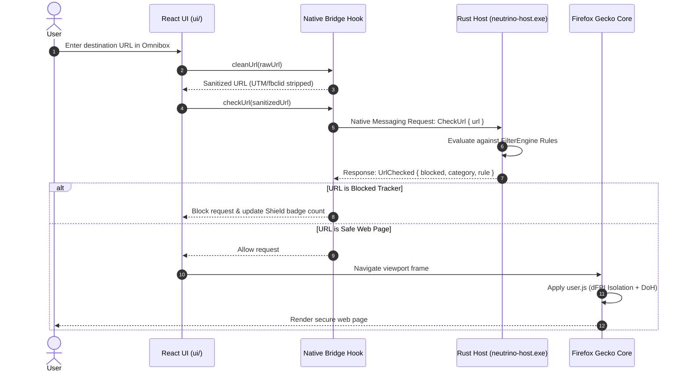

# Neutrino Browser - Architectural Specification

## 1. System Design Goals

Neutrino is architected to solve the privacy compromises and rigidity found in standard commercial browsers:
1. **Local Autonomy**: All filtering, URL classification, and state evaluation occur locally without third-party cloud analytics or external lookups.
2. **Memory Safety**: Critical interceptors, IPC parsers, and filter engines are implemented in safe Rust.
3. **Decoupled Modern UX**: The frontend UI is implemented with React 18, TypeScript, and Vite, freeing the browser window from obsolete legacy styling paradigms.
4. **Hardened Engine Base**: Leverages the battle-tested Mozilla Firefox Gecko engine with all data telemetry, experiments, and default analytics stripped out.

---

## 2. Component Tiers

### Tier 1: Frontend User Experience (`ui/`)
- **Technology**: React 18, TypeScript, Vite.
- **Responsibilities**:
  - Window frame management, tab strip lifecycle (creation, closing, muting, container coloring).
  - Omnibox address bar with live security state and URL parsing.
  - Interactive Shield control panel exposing blocked trackers and protection toggles.
  - Settings management for search engines, DoH providers, and strictness modes.
- **Communication Protocol**:
  - Connects to the Rust native core via the Mozilla WebExtension Native Messaging protocol or local bridge.

### Tier 2: Native Privacy & Engine Core (`native/`)
- **Technology**: Rust 2021 edition (`neutrino-core` and `neutrino-host.exe`).
- **Sub-engines**:
  - `FilterEngine`: High-throughput URL evaluator using hashsets and categorized threat blocklists (Trackers, Analytics, Ads, Fingerprinters, Telemetry).
  - `FingerprintShield`: Generates domain-keyed pseudo-random offsets for canvas rendering, sanitizes User-Agent strings, and manages WebGL parameter shielding.
  - `TelemetryScrubber`: Strips URL tracking query parameters (`utm_*`, `fbclid`, `gclid`).
  - `NativeProtocol`: Implements the 32-bit length-prefixed JSON stdio protocol specified by Mozilla Native Messaging.

### Tier 3: Engine Runtime & Hardening (`engine/`)
- **Technology**: Firefox / Gecko Engine, Arkenfox standard policies, source patches.
- **Configurations**:
  - `policies.json`: Disables Firefox Studies, Normandy, Telemetry, Pocket, and updates at the enterprise policy level.
  - `user.js`: Enforces strict privacy preferences (`privacy.resistFingerprinting`, `network.cookie.cookieBehavior = 5`, `network.trr.mode = 2`, `media.peerconnection.enabled = false`).
  - `manifests/neutrino_host.json`: Authorizes `neutrino.host` to communicate over standard input/output with browser processes.
  - `mozconfig.win64`: Configuration parameters for building custom stripped Gecko binaries on Windows.

### Tier 4: Packaging & Orchestration (`build.py`)
- **Technology**: Python 3.
- **Responsibilities**:
  - Toolchain verification (`cargo`, `rustc`, `node`, `npm`, `git`).
  - Compilation orchestration across Rust and Node.js.
  - Automated integration testing and live IPC roundtrip verification.
  - Distribution bundler assembling the standalone distribution in `dist/neutrino-browser/`.

---

## 3. Data & Message Flow Diagram

---

## 4. Security & Reversibility Model

- **Non-Destructive**: All engine policies and profile settings reside inside the isolated `engine/` and dedicated profile directories, without overwriting existing personal Firefox profiles.
- **Registry Hygiene**: The native messaging host is registered exclusively under `HKEY_CURRENT_USER\Software\Mozilla\NativeMessagingHosts\neutrino.host`, requiring no administrator escalation and easily uninstalled by removing the key.

